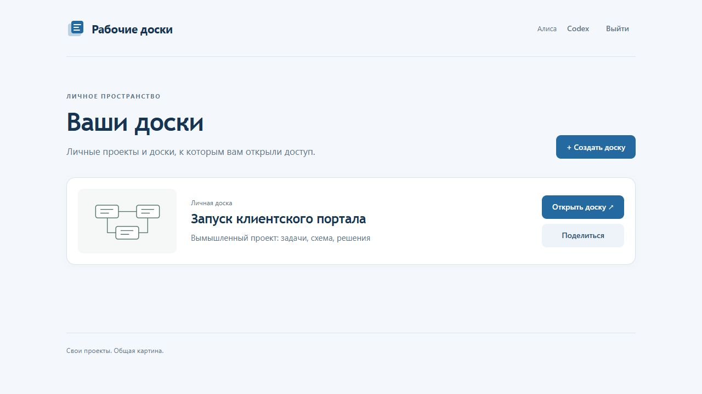
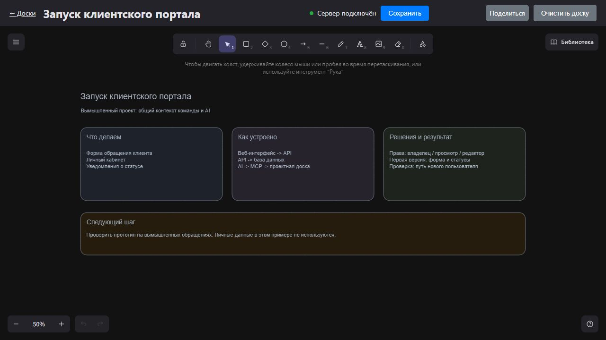

# Доски с MCP

Сервис личных и общих проектных досок на базе Excalidraw и
[mcp_excalidraw](https://github.com/yctimlin/mcp_excalidraw).
Мои дополнения: портал, права владельца/просмотра/редактирования,
гостевые ссылки, персональные ключи и единый MCP-шлюз.

Одна кодовая база для рабочего сервиса и демонстрации. В Git хранятся код,
тесты и патчи. Рабочие доски, пользователи, настройки и ключи находятся отдельно.

## Быстрый запуск

Нужны Node.js 24 и Git:

```text
git clone https://github.com/dzunnnnn-crypto/excalidraw-boards-portal.git
cd excalidraw-boards-portal
npm ci
npm run setup
npm run demo:init
npm start
```

Откройте http://127.0.0.1:8805/ . Первая подготовка скачивает зависимости и
собирает редактор, поэтому требует интернета и времени. Пароли вымышленных
пользователей alice и bob находятся в исключённом из Git файле
.local/demo-credentials.json. Инициализация повторно не перезаписывает данные.
Порт 8805 и локальный режим задаются в config.local.json.

Проверки: npm test, npm run test:upstream, npm run check:public,
npm run check:dependencies. Полный аудит выполняется до удаления
devDependencies, поскольку часть библиотек входит в браузерную сборку.
Браузерная проверка: node tests/browser-security.mjs. На Windows используется
установленный Edge, на Linux нужен Chromium Playwright. BROWSER_CHANNEL
позволяет явно выбрать канал. Сценарий создаёт отдельные вымышленные данные.

## Что можно посмотреть

- Создание личной доски, общий доступ для просмотра и правки по очереди.
- Гостевая ссылка только для просмотра и её отзыв.
- Личный ключ на странице «Codex», MCP endpoint /mcp.
- AI видит доступные пользователю доски и работает с явно указанной.
- Сохранение элементов, изображений и снимков, экспорт.



### Контекст проекта и AI на одной доске



Пример запроса AI: «Открой доску запуска клиентского портала, прочитай решения
и добавь схему: веб-интерфейс -> API -> база данных».

Агент выбирает доступную доску, читает её через MCP и добавляет элементы.
Человек видит результат в браузере, обсуждает его и редактирует дальше.
Содержание остаётся в общем контексте задачи. Правки выполняются по очереди.

## Границы

Изменения на одной доске выполняются по очереди. Настоящее одновременное
согласование конкурирующих сцен не реализовано. Стандартный лимит двух
личных редакторов рассчитан на небольшой сервер и настраивается.
Коллекции, проверяемые схемами HTTP/MCP (например, batch и списки ID),
ограничены 10000 значениями в одном запросе. Это не общий лимит размера доски.
Свой VPS не исключает передачу содержимого выбранному AI-клиенту.
Универсальная совместимость всех MCP-клиентов и независимый аудит безопасности
не заявляются. Браузер исходного редактора может загружать шрифты из CDN.

## Документация

- [Устройство](docs/architecture.md)
- [Основа и мои доработки](docs/upstream-and-changes.md)
- [Конфигурация и резервирование](docs/operations.md)
- [Релизы и будущий переход VPS](docs/release-and-upgrade.md)
- [Фактические проверки](docs/verification.md)
- [Зависимости и границы проверки безопасности](docs/security-status.md)

Лицензия дополнений MIT. Авторство и лицензии исходных проектов сохраняются
в [THIRD_PARTY_NOTICES.md](THIRD_PARTY_NOTICES.md).
Linux-релиз содержит THIRD_PARTY_INVENTORY.json и THIRD_PARTY_LICENSES/,
собранные до удаления сборочных зависимостей, включая библиотеки браузера
и локальные шрифты. Перечень намеренно расширенный, это не точный состав
каждого JS-файла. Проверка распакованного релиза:
`node scripts/collect-licenses.mjs /path/to/unpacked-release`.
[Рабочий кейс в портфолио](https://portfolio.marfino76.ru/#boards-case).

Планируемый адрес репозитория: [dzunnnnn-crypto/excalidraw-boards-portal](https://github.com/dzunnnnn-crypto/excalidraw-boards-portal).
Исправление Zod и актуальные результаты проверок описаны
в [состоянии зависимостей](docs/security-status.md).
Публикация репозитория не обновляет действующую установку VPS.
