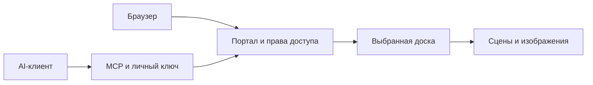

# Устройство

Общий код обслуживает личные и общие доски. MCP требует явный ID или URL
нужной доски, проверяет права до выполнения и перед возвратом результата.
Редакторы запускаются по потребности. В обычном TCP-режиме лимит относится
к личным редакторам; прежние фиксированные редакторы поддерживаются отдельно.
При `workerIsolation.mode = "bubblewrap"` личные и фиксированные редакторы
обслуживает один ограниченный пул. Каждый процесс получает только свою папку
данных и read-only движок, отдельные пространства процессов и сети. Портал
передаёт HTTP и WebSocket через Unix-сокет. Kernel lease и поколение запуска
защищают от двух писателей и ошибочной готовности после аварии.

Песочница ограничивает последствия компрометации редактора. Сам портал
остаётся доверенной частью: он проверяет права и имеет доступ к auth и доскам.
Ограничения памяти и защита администратора reverse proxy настраиваются отдельно.

Состояние доступа version:2 хранится в authStateFile. Метаданные принадлежат
владельцам, роль view не разрешает запись или управление доступами. Движок
сохраняет сцены, изображения и снимки отдельно от кода.

Портал использует локальный lock владельца auth-хранилища. Сам движок также
защищает каталог сцены от двух писателей. Это приложение для одного сервера,
не распределённая база. Изменения человеком и агентом выполняются по очереди:
согласование конкурирующих полных сцен не реализовано.

Размещение на своём сервере не исключает передачу содержимого выбранному
AI-клиенту и его провайдеру. Безопасность не проходила независимый аудит.

## Доски Telegram, 25.10.2026

MCP create_board поддерживает необязательный sharedWith (ID существующих
активных участников). Доступ edit записывается одновременно с созданием;
без этого параметра доска остаётся приватной. creationKey позволяет повторить
запрос после потери ответа без дублирования. Ключ ограничен владельцем;
повтор не восстанавливает впоследствии отозванные права.
Интеграция может передавать заранее выбранные ID участников. Сам Telegram-бот
и его приватные настройки в этот репозиторий не входят.
