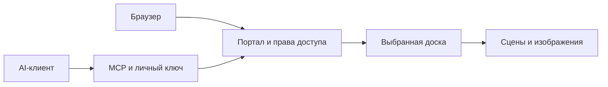

# Устройство

Общий код обслуживает личные и общие доски. MCP требует явный ID или URL
нужной доски, проверяет права до выполнения и перед возвратом результата.
Редакторы запускаются по потребности; обычный лимит двух личных редакторов
подходит небольшому серверу и настраивается. Фиксированные редакторы старой
установки продолжают поддерживаться через конфигурацию.

Состояние доступа version:2 хранится в authStateFile. Метаданные принадлежат
владельцам, роль view не разрешает запись или управление доступами. Движок
сохраняет сцены, изображения и снимки отдельно от кода.

Портал использует локальный lock владельца auth-хранилища. Сам движок также
защищает каталог сцены от двух писателей. Это приложение для одного сервера,
не распределённая база. Изменения человеком и агентом выполняются по очереди:
согласование конкурирующих полных сцен не реализовано.

Размещение на своём сервере не исключает передачу содержимого выбранному
AI-клиенту и его провайдеру. Безопасность не проходила независимый аудит.
